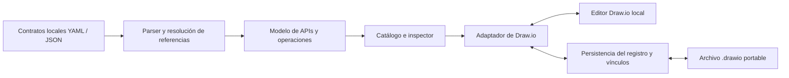

# ADR-001 — Extensión de contratos OpenAPI para Draw.io local

| Campo | Valor |
|---|---|
| Fecha | 13 de octubre de 2026 |
| Estado | Etapas técnicas 0–5 comprobadas con límites; piloto de utilidad pendiente (§21) |
| Versión del documento | 1.13 |
| Tipo de proyecto | Herramienta comunitaria de código abierto para equipos de ingeniería de software |
| Plataforma inicial | Draw.io web ejecutado localmente en el navegador |
| Distribución prevista | Repositorio público, clonación y comando de arranque |
| Evolución prevista | Despliegue del mismo editor con su extensión en una web interna |
| Nombre del producto | Pendiente; no condiciona el desarrollo |

Este ADR es la base de alcance, arquitectura y reglas de trabajo para iniciar el proyecto en un entorno de desarrollo asistido por IA. Su versión inicial especificaba lo que se debía construir. Las decisiones y evidencias de etapas 0–5 están registradas en §20–21; no hay repositorio publicado ni piloto humano aprobado.

## 1. Resumen de la decisión

Construir una extensión de Draw.io que permita importar contratos OpenAPI locales, explorar sus operaciones, arrastrar endpoints al lienzo y consultar su documentación desde el propio editor.

El editor seguirá proporcionando el dibujo, las conexiones, las formas y el guardado. La extensión añadirá semántica de contratos y una experiencia de consulta. La interpretación de OpenAPI se desarrollará como un módulo independiente del editor.

El MVP se orientará a diagramas nuevos. Permitirá crear operaciones sin contrato y vincularlas después. Cada diagrama conservará los contratos importados y las referencias de sus cajas para poder compartirse y reabrirse sin los archivos originales del autor.

La distribución inicial será local. Después de clonar el repositorio, un comando preparará los recursos necesarios y levantará Draw.io con la extensión cargada. La primera preparación podrá requerir Internet para descargar dependencias y la versión fijada del editor; el uso posterior con contratos locales deberá funcionar sin conexiones externas automáticas.

El éxito se medirá por el tiempo necesario para encontrar, comprender y utilizar endpoints durante el diseño y la revisión de un flujo.

## 2. Contexto y problema

Los equipos diseñan arquitecturas que combinan operaciones de canal/UX y APIs business o de producto existentes. Una operación del canal puede realizar validaciones, consumir varias APIs, utilizar cachés y publicar o recibir eventos.

Los contratos están en repositorios de GitHub, habitualmente con documentación por contrato. Para construir o revisar un diagrama, las personas buscan endpoints, consultan parámetros, cuerpos, headers y respuestas, y cambian entre el editor, los contratos y, cuando es necesario, el código.

Existe resistencia a adoptar nuevas webs. Se decidió conservar Draw.io y empezar con diagramas nuevos. La actualización de diagramas históricos y un eventual lineamiento del banco son posibilidades futuras, no condiciones para demostrar utilidad.

### 2.1 Evidencia del ejemplo revisado

Se revisó una captura y el archivo de referencia `creditos.xml`, proporcionados durante la definición del proyecto. Se observaron contenedores de APIs y microservicios, operaciones con método y ruta, funcionalidades, cachés, eventos y conectores.

En el XML, algunos elementos visualmente contenidos en otros son figuras independientes. Por tanto, la posición de una caja no es evidencia suficiente de su propietario técnico. Las nuevas figuras generadas por la extensión deberán guardar su identidad y pertenencia explícitamente.

El ejemplo es una referencia privada de necesidades y presentación. No debe copiarse al repositorio público, a las pruebas públicas ni a las capturas de demostración. Los ejemplos del proyecto serán ficticios.

### 2.2 Conceptos que deben permanecer separados

| Concepto | Significado |
|---|---|
| API/contrato | Superficie publicada que describe operaciones y modelos |
| Operación | Método HTTP y ruta dentro de un contrato identificado |
| Microservicio/componente | Unidad de implementación o responsabilidad arquitectónica |
| Instancia visual | Aparición de una operación o componente en un diagrama |
| Paso funcional | Validación, transformación u otra acción descrita por el autor |
| Dependencia | Relación de consumo o interacción entre participantes |
| Escenario | Recorrido ordenado, con condiciones y posibles ramas |

Un contrato no necesariamente corresponde a un solo microservicio. Una operación puede aparecer varias veces en el lienzo sin convertirse en varias operaciones distintas.

## 3. Objetivos y resultados esperados

1. Reducir el esfuerzo para encontrar operaciones reutilizables.
2. Consultar request, response y parámetros sin buscar otro documento.
3. Crear cajas de endpoints con método y ruta provenientes del contrato.
4. Conservar la forma habitual de trabajar en Draw.io.
5. Admitir diseño antes de que exista el contrato.
6. Mantener la documentación vinculada al guardar, compartir y reabrir.
7. Poder desplegar posteriormente el editor y la extensión en un entorno interno.

No se promete reconstruir la implementación a partir de OpenAPI. El contrato no permite determinar por sí solo llamadas internas, uso de Redis, orden de ejecución, transformaciones o reglas de negocio.

## 4. Decisión y alternativas

### 4.1 Camino elegido

Draw.io servido localmente, con una extensión propia cargada automáticamente y una versión del editor fijada y verificable.

La integración inicial se realizará por los mecanismos de extensión disponibles en la versión seleccionada. La carga del plugin, la inserción de figuras y la persistencia deberán demostrarse antes de desarrollar la experiencia completa.

### 4.2 Alternativas consideradas

| Alternativa | Evaluación |
|---|---|
| Funcionalidad incorporada mediante PR al repositorio principal | No es una dependencia viable: la política actual no acepta PRs externos de funcionalidades |
| Editor propio desde cero | Añade trabajo de edición gráfica y mayor fricción de adopción |
| Catálogo central conectado a GitHub | Puede aportar valor después, pero no es necesario para el MVP local |
| Generador de bibliotecas para la web oficial | Puede servir como alternativa limitada; no demuestra por sí solo la consulta integrada de contratos |
| Extensión del navegador sobre la web oficial | Añade restricciones de distribución y permisos; no es el camino inicial |
| Draw.io local con extensión | Camino seleccionado para probar y desarrollar el MVP |

### 4.3 Consecuencias

- Se reutiliza la experiencia de dibujo existente.
- Se asume el costo de comprobar compatibilidad con actualizaciones de Draw.io.
- Una futura web interna tendrá una dirección propia, aunque conserve el editor conocido.
- Los diagramas serán más grandes al incorporar contratos; deberá medirse el tamaño y el tiempo de apertura.
- La documentación corresponderá a la revisión importada, no necesariamente a la API actualmente desplegada.
- La extensión no depende de reconocimiento como contribuidor del repositorio principal. Su código y mantenimiento tendrán un repositorio independiente.

## 5. Experiencia del usuario

### 5.1 Contrato primero

1. Abrir el editor local.
2. Elegir **Importar contrato** y seleccionar un YAML o JSON.
3. Revisar el nombre de la API, versión y resultado de la importación.
4. Buscar operaciones por API, método, ruta, resumen o descripción.
5. Arrastrar una operación al lienzo.
6. Conectarla y añadir funcionalidades con las herramientas normales del editor.
7. Seleccionarla para consultar su documentación automáticamente en el lateral derecho.
8. Guardar y reabrir el archivo sin perder el vínculo.

### 5.2 Arquitectura primero

1. Crear una caja sin contrato, con propósito y, si se conocen, método y ruta previstos.
2. Marcarla como **Pendiente de contrato**.
3. Importar el contrato cuando exista.
4. Elegir **Vincular contrato** y seleccionar explícitamente la operación.
5. Mostrar las diferencias entre la etiqueta prevista y el método/ruta importados.
6. Conservar las funcionalidades, conexiones y notas del autor.

No se generará un contrato válido a partir de notas o cajas en el MVP.

### 5.3 Presentación

- Catálogo en un panel o biblioteca lateral integrado al editor.
- Lienzo con cajas compactas: API propietaria, método, ruta y propósito breve si existe.
- Consulta de contrato en un panel o ventana del propio editor, sin abrir otra web.
- Parámetros agrupados por ubicación; request y responses en secciones diferenciadas.
- Respuestas de éxito y error visibles, con sus códigos y tipos de contenido.
- Ejemplos del contrato identificados como tales; los ejemplos generados, si se incorporan posteriormente, tendrán otra identificación.
- Indicación de API, versión declarada y revisión importada.
- Acceso alternativo mediante **Añadir al lienzo** para quien no utilice arrastre.
- La documentación debe ser accesible mediante teclado y desplazamiento normal.
- La doble pulsación y la edición habitual de etiquetas no deben romperse para abrir el inspector.

La presentación tomará como referencia la convención de contenedor, endpoint y funcionalidad del ejemplo revisado, con datos ficticios. La capa UX/BS, el componente de implementación y el color no se deducirán automáticamente de nombres o tags del contrato.

## 6. Alcance funcional del MVP

| ID | Capacidad obligatoria | Criterio de aceptación |
|---|---|---|
| F01 | Importación local | Leer YAML y JSON soportados; informar errores sin alterar el diagrama |
| F02 | Varios contratos | Mostrar operaciones de dos o más APIs y distinguir su procedencia |
| F03 | Catálogo y búsqueda | Buscar por API, método, ruta, resumen y descripción; distinguir coincidencias entre APIs |
| F04 | Arrastre/inserción | Insertar una operación con identidad persistente y etiqueta correcta |
| F05 | Consulta integrada | Mostrar parámetros efectivos, request, responses, tipos de contenido y seguridad |
| F06 | Operaciones pendientes | Crear una figura pendiente y vincularla después sin perder su trabajo visual |
| F07 | Guardado portable | Reabrir en otra sesión/perfil con extensión, sin archivos de contrato ni caché del autor |
| F08 | Edición normal | Conservar movimiento, redimensionado, conexiones, copia y deshacer/rehacer |
| F09 | Diagnósticos | Diferenciar archivo inválido, versión no soportada, referencia no soportada y vínculo perdido |
| F10 | Arranque reproducible | Un comando prepara y arranca la distribución desde un clon limpio |

### 6.1 Compatibilidad OpenAPI inicial

El usuario confirmó **OpenAPI 3.1.x como línea principal** y solicitó soporte para las anteriores: **OpenAPI 3.0.x y Swagger 2.0**, con YAML y JSON autocontenidos. La ampliación está acordada expresamente; reemplaza la propuesta inicial limitada a 3.0.x. [ADR-003](docs/adr/ADR-003-openapi-versiones.md) define la separación de reglas, límites y pruebas de esta compatibilidad. No se presupone equivalencia entre versiones ni se convierte el snapshot original.

Para la versión seleccionada, contemplar:

- Métodos HTTP definidos por OpenAPI; el caso de demostración usará GET, POST y PATCH.
- Parámetros definidos en Path Item y Operation, respetando las reglas de reemplazo.
- Parámetros de path, query, header y cookie.
- Request bodies, tipos de contenido, propiedades requeridas y ejemplos disponibles.
- Responses explícitas, `default` y rangos de códigos admitidos por la versión.
- Headers de respuesta.
- Seguridad global y reemplazo por operación, incluyendo seguridad vacía declarada explícitamente.
- Referencias internas mediante JSON Pointer y detección de ciclos.
- Presentación de `allOf`, `oneOf` y `anyOf` como composiciones; no aplanarlas inventando un único esquema.

Las referencias a URLs o archivos externos no se descargarán automáticamente. Si el documento las requiere, la importación se rechazará con un diagnóstico concreto en esta versión. Los esquemas recursivos internos podrán mostrarse como referencias expandibles con profundidad limitada, sin expansión infinita.

El sistema no se presentará como un validador completo de OpenAPI. Debe validar el subconjunto necesario para importar y consultar correctamente, y hacer explícitas sus limitaciones.

### 6.2 Fuera del MVP

- Conexión a GitHub, autenticación y sincronización de repositorios.
- Catálogo central institucional y permisos de equipos.
- Conversión automática de diagramas históricos.
- Descubrimiento de arquitectura desde código o trazas.
- Generación automática de contratos o implementación de microservicios.
- Comparación de compatibilidad semántica entre payloads de servicios.
- Mapeo de campos, transformaciones y propagación de datos entre operaciones.
- Ejecución de llamadas reales o función «Try it out».
- Animación de escenarios y exportación a GIF.
- Edición colaborativa en tiempo real.
- Reconciliación completa entre revisiones de contratos.

## 7. Modelo de información y persistencia

### 7.1 Entidades mínimas

| Entidad | Datos conceptuales |
|---|---|
| API lógica | Identificador interno estable, nombre visible, clasificación manual opcional |
| Revisión del contrato | Identificador, API lógica, formato/versión OpenAPI, `info.version`, huella del archivo, contenido importado |
| Referencia de operación | API lógica, revisión, método, path exacto, `operationId` opcional |
| Instancia de endpoint | Identidad visual, referencia de operación o estado pendiente, notas y propósito del autor |
| Paso funcional | Texto del autor y relación explícita con su instancia de endpoint, cuando se use esa relación |
| Registro del diagrama | Versión del formato de la extensión y colección de revisiones necesarias |

### 7.2 Reglas de identidad

1. Una ruta sola no identifica una operación: debe conservar API, revisión y método.
2. `operationId` será auxiliar; no es obligatorio y no es único entre contratos distintos.
3. `info.title`, el nombre del archivo y los tags no son identificadores estables ni prueba de un microservicio propietario.
4. Conservar el path literal del contrato, incluyendo mayúsculas y barras. No igualar automáticamente parámetros con nombres distintos ni modificar rutas para hacerlas coincidir.
5. Una huella SHA-256 de los bytes del archivo permite detectar una importación idéntica. Archivos semánticamente equivalentes con distinto formato pueden tener huellas distintas; el MVP no promete deduplicación semántica.
6. Duplicar una figura genera otra instancia visual que apunta a la misma operación y revisión.
7. Importar el mismo archivo no debe multiplicar el catálogo ni las copias del contrato innecesariamente.
8. Un archivo distinto con el mismo título no sustituye automáticamente una revisión existente.

### 7.3 Persistencia acordada

- El entregable principal seguirá siendo un archivo `.drawio` con los metadatos de la extensión.
- Guardar cada revisión de contrato una sola vez en el registro lógico del documento, no una copia completa por endpoint.
- Las figuras guardarán referencias al registro y su estado pendiente/vinculado.
- La ubicación exacta del registro en el XML y su serialización deben validarse en la etapa 0 contra los mecanismos reales del editor.
- No depender de propiedades desconocidas que el serializador descarte ni de modificar manualmente texto XML con reemplazos frágiles.
- El contenido del contrato debe conservar la información necesaria para resolver referencias internas y mostrar documentación. Se puede preservar el archivo original como snapshot; evitar copias redundantes sin justificación.
- `localStorage` o memoria pueden usarse como caché o preferencias, nunca como única fuente de los contratos o vínculos.
- Incluir una versión del formato de persistencia de la extensión.
- Ante una versión de metadatos no soportada, informar la limitación y evitar reescribirla silenciosamente.
- Un vínculo perdido debe seguir mostrando la caja y sus notas, con el estado **Contrato no disponible**.
- No eliminar una revisión que tenga instancias vinculadas sin explicar qué vínculos se afectarán.

### 7.4 Copia, páginas y compatibilidad

El MVP debe probar duplicación y copia dentro del mismo documento. Copiar a otro documento deberá transportar las revisiones necesarias o impedir explícitamente esa operación para figuras vinculadas; nunca dejar una copia aparentemente válida con documentación equivocada. La solución preferida es transportar y deduplicar las revisiones.

El registro lógico corresponde al documento; debe atender las páginas del archivo y no perder información al cambiar o duplicar páginas. La etapa 0 debe comprobar qué mecanismos ofrece la versión elegida.

Un Draw.io sin la extensión deberá poder abrir el archivo y mostrar las figuras básicas. No se garantiza todavía que todos los metadatos sobrevivan a cualquier modificación realizada sin la extensión: se probará el recorrido abrir/guardar y se documentará el resultado. No anunciar compatibilidad de ida y vuelta antes de verificarla.

## 8. Arquitectura técnica propuesta



### 8.1 Separación de responsabilidades

| Módulo | Responsabilidad | Restricción |
|---|---|---|
| `contracts` | Lectura, normalización, referencias y diagnósticos | No conoce Draw.io ni el DOM |
| `model` | Identidades, revisiones y referencias | No interpreta posición como propiedad |
| `drawio-adapter` | Selección, inserción, metadatos y transacciones del editor | Concentra las dependencias de APIs de Draw.io |
| `catalog` | Lista, búsqueda e inserción de operaciones | No modifica contratos |
| `inspector` | Documentación de la operación seleccionada | No ejecuta llamadas HTTP |
| `persistence` | Lectura/escritura versionada y deduplicación | No depende de la caché del navegador |
| `runtime` | Preparación, configuración local y servidor estático | No recibe los contratos para procesarlos |

El nuevo código se escribirá preferentemente en TypeScript y se empaquetará como JavaScript compatible con el editor. La selección de parser YAML, validador y herramientas de empaquetado queda para la etapa 0, con versiones fijadas y justificación breve. No incorporar un framework completo para resolver únicamente una lista y un inspector.

### 8.2 Relación con el código de Draw.io

- Fijar un tag/commit y una huella verificable de los recursos descargados. No usar `latest` como dependencia de ejecución.
- Mantener el código propio separado de la distribución del editor.
- Usar los puntos de extensión comprobados y configuración de arranque controlada.
- Generar los archivos de configuración/overlays necesarios de forma reproducible.
- Evitar modificaciones dispersas al código base y sustituciones globales de funciones internas.
- Si una capacidad requiere un parche del editor, registrar su necesidad y alternativas en otro ADR antes de incorporarlo.
- No depender de que la web oficial permita cargar el plugin.
- Comprobar el ciclo de carga del plugin; no basar el arranque en esperas arbitrarias o en variables globales no documentadas.
- No usar una opción global de modo offline sin comprobar sus efectos: la documentación actual indica que algunas opciones deshabilitan plugins.

## 9. Distribución local y futura web interna

### 9.1 Contrato de instalación

Prerrequisitos iniciales: Git y una versión soportada de Node.js con npm. La versión exacta de Node.js se fijará y documentará durante la etapa 0.

La experiencia de arranque siguiente está implementada y verificada desde un clon local ficticio limpio. La URL de un repositorio publicado sigue siendo un marcador; no se ha publicado el proyecto:

```text
git clone <URL-del-repositorio>
cd <directorio-del-proyecto>
npm start
```

`npm start` debe funcionar desde un clon limpio sin una instalación manual adicional de Draw.io. El bootstrap puede usar un script mínimo con utilidades estándar de Node.js para instalar dependencias fijadas mediante el lockfile, preparar la versión fijada del editor y arrancar la aplicación.

Ese comando debe:

1. Validar los prerrequisitos con mensajes comprensibles.
2. Preparar dependencias y editor solo cuando sea necesario.
3. Descargar desde fuentes oficiales y verificar la versión/huella fijadas.
4. Cargar la extensión sin intervención manual en menús o consola.
5. Servir en loopback por defecto y mostrar la dirección local y cómo detener el proceso.
6. Explicar conflictos de puerto y fallos de descarga, sin dejar una instalación aparentemente exitosa.
7. Ser idempotente y funcionar en Windows/PowerShell; probar también otro sistema antes de anunciar soporte multiplataforma.

No exigir Docker, Python, privilegios de administrador o instalaciones globales para el recorrido inicial. La instalación inicial y el uso posterior sin red deben documentarse como situaciones diferentes.

### 9.2 Empaquetado

La opción inicial propuesta es descargar/cachar el editor fijado durante el bootstrap en un directorio de runtime ignorado por Git. La etapa 0 deberá comprobar que el mecanismo es reproducible y funciona en Windows. Si resulta necesario distribuir los recursos del editor dentro del repositorio o de un paquete, registrar la decisión y su impacto.

La publicación para una web interna debe producir un artefacto que incluya editor, extensión y recursos estáticos; no debe descargar código de terceros en cada visita. Reutilizar el mismo procesamiento de contratos en el navegador, con una configuración de despliegue distinta.

No construir todavía una API de negocio, base de datos de contratos, autenticación o infraestructura institucional.

## 10. Tratamiento de datos y límites técnicos

- Los contratos del usuario se procesan en el navegador; no se envían al servidor local, a terceros ni a servicios de IA.
- No incluir contratos, diagramas, capturas, URLs internas ni credenciales del banco en el repositorio público.
- El servidor local sirve recursos de la aplicación; no necesita recibir archivos importados.
- Las integraciones de almacenamiento remoto, generación con IA, analítica y telemetría no forman parte de la distribución del MVP. Configurar y verificar el comportamiento real del editor elegido, sin prometer privacidad solo porque la extensión no haga llamadas.
- Servir localmente los recursos necesarios. Los enlaces a documentación externa pueden abrirse por acción explícita del usuario, sin considerarlos parte del funcionamiento automático.
- No ejecutar contenido del contrato: tratar descripciones como datos, escapar etiquetas y sanitizar el Markdown/HTML que se muestre. Evitar HTML crudo en la primera versión si simplifica una presentación segura.
- Usar parsing YAML seguro, límites de alias/profundidad y límites de tamaño para impedir bloqueos accidentales. No utilizar evaluación de código para leer documentos.
- La importación debe ser atómica: un archivo rechazado no deja figuras, vínculos o registros parcialmente insertados.
- La figura no afirma que la implementación, el endpoint desplegado o las reglas de negocio coincidan con el contrato importado.
- El diagrama con snapshots puede compartirse junto con la documentación que contiene; explicarlo en el guardado y en el README sin diálogos repetitivos.

### 10.1 Presupuesto inicial para la prueba

Usar como objetivos provisionales de producto, no como capacidades ya medidas:

- 3 contratos autocontenidos, hasta 100 operaciones cada uno.
- Hasta 5 MiB por archivo importado y 15 MiB de contratos por documento.
- Importación de un contrato de prueba en menos de 3 segundos.
- Resultados de búsqueda en menos de 300 ms sobre ese conjunto.
- Sin congelamientos perceptibles al seleccionar una operación o mover una figura.

Registrar equipo, navegador, tamaño, operaciones y mediciones. Ajustar los presupuestos con evidencia en el piloto; no optimizar para miles de contratos antes de medir el caso inicial.

## 11. Etapas de trabajo y criterios de salida

Las etapas son secuenciales. Cada una debe dejar un resultado comprobable. No avanzar sobre una dependencia fallida ni implementar toda la hoja de ruta en una sola entrega. No se asignan fechas ni estimaciones hasta completar la etapa 0.

### Etapa 0 — Prueba de viabilidad y decisiones de base

**Objetivo:** comprobar que el camino elegido soporta la experiencia y la persistencia esenciales.

**Trabajo:**

- Seleccionar y fijar una versión de Draw.io y el runtime de desarrollo.
- Levantar el editor local con un plugin mínimo cargado automáticamente.
- Añadir una acción y una figura con datos ficticios.
- Probar selección, lectura de metadatos y un panel/ventana sencillo.
- Guardar un pequeño registro de contrato y un vínculo; cerrar y reabrir en un perfil limpio.
- Comprobar duplicación de figura, cambio/duplicación de página y deshacer/rehacer.
- Abrir el archivo en un editor sin extensión y comprobar visualización y conservación tras guardar.
- Verificar arranque y recursos con la red desconectada después de preparar la instalación.
- Confirmar la versión OpenAPI de entrada o documentar que la prueba usa provisionalmente 3.0.x.
- Elegir parser, empaquetado, serialización y mecanismo de integración con criterios de mantenimiento y licencias.

**Entregables:** prueba mínima ejecutable, notas de compatibilidad, versiones fijadas y este ADR actualizado con las decisiones verificadas.

**Salida:** la figura y su vínculo sobreviven al guardado; se puede mostrar su documentación desde el editor; la extensión carga de forma reproducible. Si falla una condición fundamental, documentar el bloqueo y evaluar otra integración antes de construir el catálogo.

### Etapa 1 — Repositorio y arranque reproducible

**Objetivo:** que otro desarrollador pueda ejecutar la prueba desde un clon limpio.

**Trabajo:** estructura modular, bootstrap, lockfile, configuración local, ejemplos ficticios, README, licencia/avisos aplicables y verificaciones automatizadas mínimas.

**Salida:** `npm start` desde un clon limpio levanta editor y extensión en Windows; un segundo arranque reutiliza recursos; los errores comunes son claros. Las reglas de la sección 14 se reflejan en un `AGENTS.md` del repositorio que remite a este ADR.

### Etapa 2 — Importación y modelo de contratos

**Objetivo:** interpretar los documentos soportados sin depender del lienzo.

**Trabajo:** YAML/JSON, validación necesaria, listado de operaciones, parámetros y seguridad efectivos, referencias internas, ciclos, diagnósticos, identidades y deduplicación de archivos idénticos.

**Salida:** las fixtures verifican casos válidos e inválidos; APIs con el mismo método/ruta no se mezclan; una referencia externa o versión no soportada genera un diagnóstico preciso; las importaciones fallidas no alteran el documento.

### Etapa 3 — Catálogo, búsqueda y figuras

**Objetivo:** usar las operaciones importadas para crear el diagrama.

**Trabajo:** biblioteca/panel, búsqueda, arrastre y botón de inserción, estilo de endpoint, clasificación manual, instancias vinculadas, operaciones pendientes y vinculación posterior.

**Salida:** importar dos APIs, distinguir sus operaciones, insertar tres endpoints y una operación pendiente, conectarlas y vincular la pendiente sin perder notas. Verificar movimiento, redimensionado y transacciones de deshacer/rehacer.

### Etapa 4 — Inspector de documentación

**Objetivo:** comprender una operación sin salir del editor.

**Trabajo:** parámetros efectivos, cuerpos, composiciones de esquemas, respuestas, headers, seguridad, ejemplos y procedencia; navegación de referencias con profundidad limitada.

**Salida:** una operación ficticia con referencias internas, parámetros heredados, request y varias respuestas se consulta correctamente. El inspector distingue información ausente, opcional y requerida, y no interpreta una descripción como código o HTML ejecutable.

### Etapa 5 — Portabilidad y cierre del MVP

**Objetivo:** garantizar que el trabajo continúa después de cerrar o compartir el archivo.

**Trabajo:** registro final de contratos, formato versionado, reapertura, varias páginas, copia/duplicación, vínculos huérfanos, revisiones diferentes, presupuesto de tamaño y pruebas del recorrido completo.

**Salida:** ejecutar la demostración de la sección 12 desde una instalación/perfil limpio; reabrir sin contratos originales; conservar identidad, geometría, conexiones y notas; comprobar funcionamiento sin red y documentar la compatibilidad real con el editor sin extensión.

### Etapa 6 — Piloto y evaluación de utilidad

**Objetivo:** comprobar el beneficio para LT y desarrolladores.

**Trabajo:** piloto con 3–5 participantes si están disponibles, misma tarea con el flujo actual y la extensión, orden de prueba alternado para reducir el efecto de aprendizaje, registro de tiempos, errores y fricciones.

**Métricas:** tiempo para localizar una operación, responder preguntas sobre request/response y construir un flujo nuevo; exactitud; fallos de guardado; necesidad de asistencia; esfuerzo para volver a usarla.

**Criterio provisional:** reducción mediana de al menos 25 % en el tiempo combinado de búsqueda/consulta/construcción, sin deterioro de exactitud, y al menos dos participantes interesados en usarla en su siguiente diagrama. Es un umbral propuesto para decidir, no una previsión ni evidencia estadística concluyente con una muestra pequeña.

**Salida:** decisión documentada de continuar, corregir la experiencia o reducir el proyecto. No asumir éxito a partir de una demostración preparada por el autor.

## 12. Demostración y definición de terminado del MVP

### 12.1 Escenario ficticio de aceptación

1. Arrancar desde un clon limpio.
2. Importar dos contratos ficticios: API de clientes y API de ofertas.
3. Buscar una consulta de cliente y una operación de oferta.
4. Arrastrar tres operaciones; incluir rutas iguales de distintas APIs para verificar que no se confundan.
5. Crear una operación UX pendiente y una figura libre de caché.
6. Añadir conexiones y una funcionalidad manual.
7. Consultar parámetros, request, respuestas y seguridad de una operación.
8. Vincular la operación pendiente a un contrato ficticio adicional.
9. Duplicar una figura y comprobar la referencia compartida.
10. Guardar, cerrar y abrir en un perfil limpio con la extensión, sin cargar los YAML/JSON originales.
11. Verificar que las cajas muestran la documentación correcta y mantienen el trabajo visual.
12. Repetir la consulta con la red desconectada después de preparar los recursos.

### 12.2 Definición de terminado

- Todas las capacidades F01–F10 pasan sus criterios.
- El recorrido de aceptación es repetible por otra persona.
- Los tests del parser cubren semántica relevante; los tests de integración cubren persistencia e identidad.
- Un contrato inválido, una referencia externa, un ciclo, una versión no soportada y un vínculo perdido tienen comportamiento definido.
- No existe procesamiento remoto ni tráfico externo automático necesario para usar el MVP ya preparado.
- El README especifica versiones soportadas, prerrequisitos, comando, límites y solución a errores habituales.
- El repositorio no contiene material privado del banco.
- La versión de Draw.io y las dependencias son reproducibles y se conservan los avisos aplicables.
- Se documentan limitaciones verificadas. «Probablemente funciona» no equivale a un criterio aprobado.

## 13. Evolución posterior al piloto

El orden puede cambiar con evidencia, mediante una actualización de alcance. Estas capacidades no están autorizadas como trabajo automático del MVP.

| Etapa futura | Alcance | Condición para empezar |
|---|---|---|
| 7. Actualización de contratos | Importar una revisión nueva, mostrar diferencias, relink explícito y conservar notas/geometría | MVP útil y persistencia estable |
| 8. Escenarios y animación | Orden, condiciones, ramas, eventos, respuestas y recorrido visual; evaluar exportación GIF existente | Modelo de escenarios definido y separado de dependencias |
| 9. Diagramas históricos | Asociación manual asistida por método/ruta/propietario, sin confundir posición con pertenencia | Demanda comprobada y referencias fiables |
| 10. Despliegue interno | Artefacto estático, configuración por entorno y documentación operativa | Aprobación organizacional y piloto favorable |
| 11. GitHub/catálogo compartido | Selección de repositorios, versiones, permisos y sincronización | Necesidad demostrada; ADR específico para datos y autenticación |
| 12. Evidencia de implementación | Código, contratos desplegados o trazas; estados confirmado/inferido/pendiente | Fuentes y reglas de confianza definidas |

### Reglas para las ampliaciones

- Una revisión nueva no sustituye silenciosamente los contratos ya utilizados.
- Un endpoint extra en un contrato reutilizado no es automáticamente un error de arquitectura.
- La existencia de una operación no demuestra compatibilidad entre payloads conectados; se necesita mapeo de datos.
- Las flechas de dependencia no implican orden de ejecución. Animar solo escenarios definidos y marcar lo inferido.
- Una respuesta contractual no confirma el comportamiento real del servicio.
- Antes de desarrollar otro motor de animación, comprobar las capacidades de la versión fijada de Draw.io.

## 14. Reglas de trabajo para desarrolladores y agentes de IA

Estas reglas forman parte del ADR y deben trasladarse al `AGENTS.md` del repositorio al comenzar. `AGENTS.md` resumirá el proceso y enlazará el ADR; no debe crear una segunda definición contradictoria del alcance.

### 14.1 Inicio y continuidad

1. Leer este ADR y las instrucciones del repositorio antes de modificar código.
2. Revisar qué está implementado y comprobado; no reiniciar trabajo que ya existe.
3. Trabajar en la etapa más temprana cuyos criterios estén pendientes.
4. Mantener un documento de progreso con etapa, criterios cumplidos, evidencias, limitaciones y siguiente paso.
5. No confundir un scaffold, una captura o un mock con una funcionalidad terminada.
6. Si el entorno no permite ejecutar una comprobación, registrar «no verificada» y el procedimiento necesario; no declarar éxito.

### 14.2 Alcance y decisiones

7. Implementar una porción pequeña, ejecutable y revisable por entrega.
8. Resolver decisiones rutinarias dentro del alcance sin pedir confirmación para cada detalle.
9. Consultar cuando se requiera una decisión de producto, información ausente imprescindible o una modificación sustancial del alcance.
10. No adelantar GitHub, animaciones, migración histórica, backend institucional o generación con IA por iniciativa propia.
11. Documentar decisiones significativas con un nuevo ADR enlazado: parche del editor, cambio del formato persistido, ampliación de versiones OpenAPI, almacenamiento remoto o autenticación.
12. Los cambios de requisitos acordados con el usuario prevalecen; actualizar el ADR y sus criterios para evitar contradicciones.
13. No delegar a subagentes ni añadir mecanismos de coordinación sin solicitud explícita del usuario o instrucciones aplicables del repositorio.

### 14.3 Calidad y mantenimiento

14. Mantener parser/modelo independientes de Draw.io y de la interfaz.
15. Encapsular acceso al editor en un adaptador pequeño. No propagar tipos o llamadas del editor por toda la aplicación.
16. Usar librerías mantenidas para YAML y las tareas de esquema necesarias; justificar dependencias y fijar versiones. No crear un parser YAML/OpenAPI improvisado.
17. Usar las reglas semánticas de la versión OpenAPI seleccionada; no suponer que 3.0 y 3.1 son intercambiables.
18. Respetar las transacciones del editor para cambios atómicos y deshacer/rehacer.
19. Evitar funciones gigantes, estado global disperso, lógica duplicada y cambios de etiquetas usados como identidad.
20. Conservar notas, geometría, conectores y referencias al actualizar datos. No aplicar auto-layout sin acción del usuario.
21. No editar código base de Draw.io salvo decisión documentada. Los overlays/configuraciones deben ser mínimos y reproducibles.
22. Las nuevas figuras deben guardar relaciones semánticas explícitas; no reconstruir su propiedad por coordenadas.
23. No incorporar herramientas o frameworks cuyo costo supere el beneficio del caso actual.

### 14.4 Verificación

24. Probar semántica del contrato: parámetros heredados/reemplazados, seguridad efectiva, referencias, ciclos y responses.
25. Probar identidad y persistencia: mismo path entre APIs, duplicados, varias páginas, perfiles limpios y ausencia del contrato original.
26. Realizar una prueba de integración del recorrido importar → insertar → consultar → guardar → reabrir.
27. Verificar tráfico de red y recursos del editor para sostener la afirmación de uso local; no comprobar solo el código de la extensión.
28. Crear tests útiles para riesgos reales; no repetir la implementación en tests ni inventar cobertura numérica como objetivo.
29. Ejecutar los checks relevantes tras los cambios. Ampliar verificaciones cuando una falla o una modificación nueva lo justifique.
30. Registrar evidencias de los criterios de salida antes de marcar una etapa completa.

### 14.5 Datos y publicación

31. Trabajar con contratos y diagramas ficticios en fixtures, ejemplos y capturas públicas.
32. Mantener fuera de Git datos del usuario, cachés, runtime descargado y archivos temporales que no sean entregables.
33. No ejecutar requests descritas en contratos ni resolver URLs externas automáticamente.
34. No añadir IA, analítica, servicios externos o credenciales como requisito del MVP.
35. Preparar el repositorio para publicación no autoriza a publicarlo, subir archivos o contactar a terceros. Esas acciones requieren la instrucción correspondiente.
36. Conservar atribuciones, licencia y avisos de Draw.io y de las dependencias. El producto propio no debe presentarse como oficial ni patrocinado por Draw.io.

### 14.6 Comunicación de cada entrega

37. Explicar qué cambió, qué criterio satisface, cómo se verificó y qué queda pendiente.
38. Comunicar bloqueos concretos con evidencia y alternativa, sin seguir desarrollando sobre una suposición fallida.
39. Mantener README, progreso y decisiones sincronizados con el comportamiento real.
40. No prometer fechas, rendimiento, compatibilidad o aceptación institucional que no se hayan comprobado.

## 15. Organización inicial sugerida del repositorio

Esta estructura es orientativa; se ajustará si la etapa 0 revela necesidades reales de integración.

```text
AGENTS.md
README.md
LICENSE
THIRD_PARTY_NOTICES.md
package.json
package-lock.json
docs/
  adr/
    ADR-001-extension-contratos-drawio.md
  progreso.md
  compatibilidad.md
src/
  contracts/
  model/
  drawio-adapter/
  catalog/
  inspector/
  persistence/
scripts/
  bootstrap.mjs
  start.mjs
config/
  drawio-version.json
examples/
  contracts/
  diagrams/
tests/
  fixtures/
  unit/
  integration/
.runtime/       # ignorado por Git
work/           # ignorado por Git
```

No crear un monorepo de muchos paquetes, servicios o despliegues si un proyecto modular único cubre el MVP.

## 16. Riesgos y respuestas previstas

| Riesgo | Respuesta |
|---|---|
| El plugin no carga o depende de APIs inestables | Prueba de viabilidad, versión fijada y adaptador aislado |
| Metadatos perdidos al guardar | Verificar serialización antes del catálogo; formato versionado y round-trip |
| Documentación equivocada por coincidencia de nombres/rutas | Identidades explícitas de API, revisión y operación |
| Contratos grandes o referencias complejas | Presupuestos medidos, límites y expansión controlada |
| Otra URL reduce adopción | Conservar editor y recorrido conocidos; comprobarlo con usuarios |
| Mantenimiento de un fork crece | Extensión separada y cambios al editor mínimos/documentados |
| El diagrama presenta una arquitectura no demostrada | Distinguir contrato, relaciones declaradas y evidencia de implementación |
| Se empieza a migrar todo antes de probar valor | Diagramas nuevos primero y piloto antes de ampliaciones |
| Contenido interno acaba en un repo público | Ejemplos ficticios, exclusiones de Git y revisión de entregables |

## 17. Decisiones pendientes y cómo resolverlas

| Pendiente | Momento | Evidencia necesaria |
|---|---|---|
| Versión exacta de Draw.io | Resuelta en etapa 0: 32.4.1 | Plugin/persistencia comprobados; §20 y compatibilidad |
| Versiones OpenAPI | Resuelta por el usuario: 3.1.x principal; 3.0.x y Swagger 2.0 compatibles | ADR-003; compatibilidad de cada línea sujeta a pruebas de etapa 2 |
| Versión de Node.js y dependencias | Resuelta en etapas 0–1 | Node 24.18.0/npm 11.16.0 y lockfile; instalación limpia comprobada |
| Ubicación/serialización del registro de contratos | Resuelta para prueba de etapa 0 | Atributo mxfile; ADR-002 y pruebas de páginas; extensión de MVP pendiente |
| Panel o ventana para el inspector | Diálogo probado en etapa 0; experiencia completa en etapa 4 | Interacción compatible con el editor; semántica completa aún pendiente |
| Copia entre documentos | Etapas 0 y 5 | Transporte/deduplicación de revisiones o limitación explícita |
| Licencia del código propio | Antes de publicar | Elección del responsable y compatibilidad con dependencias |
| Nombre, URL y responsable del repositorio | Antes de publicar | Decisión del usuario |
| Condiciones de la web interna | Después del piloto | Requisitos de infraestructura y acceso de la organización |

Estas decisiones no obligan a detener el proyecto entero: avanzar en trabajo independiente y resolver cada una antes de la etapa que la necesita.

## 18. Fuentes y grado de certeza

Fuentes consultadas el 13 de octubre de 2026. Su comportamiento deberá contrastarse con la versión del editor seleccionada.

- [Repositorio y README de Draw.io](https://github.com/jgraph/drawio): distribución, licencia del código, política de contribuciones y uso de marca. El nombre y licencia definitivos de nuestro producto siguen pendientes.
- [Guía de contribuciones](https://github.com/jgraph/drawio/wiki/Contributing): política actual sobre PRs externos y excepción de traducciones. El MVP no depende de aceptación upstream.
- [Guía de plugins](https://github.com/jgraph/drawio/wiki/Plugins): carga mediante `Draw.loadPlugin`, configuración de instalaciones propias y restricciones de carga. La integración concreta requiere la etapa 0.
- [OpenAPI 3.0.4](https://spec.openapis.org/oas/v3.0.4.html): operaciones, parámetros, seguridad, referencias y links. Los links del contrato no constituyen un modelo completo de orquestación interna.
- [Exportaciones de Draw.io](https://www.drawio.com/blog/export-formats/): exportación de animaciones de conectores a GIF. Solo es una referencia para una etapa posterior; no se ha probado una animación de este proyecto.

No se han revisado contratos reales ni código de los microservicios. La convención visual se observó en la referencia proporcionada; sus relaciones técnicas y compatibilidad contractual no se validaron.

## 19. Instrucción inicial para comenzar el desarrollo

El siguiente texto puede usarse como primera instrucción en el nuevo proyecto, adjuntando este ADR:

> Usa ADR-001 como base del proyecto y sus reglas de trabajo. Comienza por la etapa 0: inspecciona el entorno, selecciona y fija una versión de Draw.io, levanta el editor local y demuestra que una extensión propia puede insertar una figura, mostrar documentación ficticia y conservar el vínculo y un snapshot de contrato al guardar y reabrir en un perfil limpio. Mantén la interpretación del contrato separada del adaptador del editor. Documenta compatibilidad, pruebas y decisiones pendientes, y crea AGENTS.md y un registro de progreso coherentes con el ADR. No implementes todavía GitHub, animación, migración histórica ni una web distinta del editor acordado. Continúa con las siguientes etapas cuando los criterios anteriores estén comprobados y reporta el resultado de cada entrega. Usa únicamente ejemplos ficticios en el repositorio y no publiques ni subas archivos sin una instrucción expresa.

## 20. Decisiones verificadas de las etapas 0–1

Registro histórico de la entrega inicial. Las ampliaciones posteriores y el estado actual figuran en §21.

Actualización del 13 de octubre de 2026 (America/Lima); versión del documento 1.1. El alcance del MVP permanece como se define arriba.

- **Editor:** Draw.io 32.4.1, commit `9034053fba80a435e27d68d374bc564b83917ae9`, WAR oficial con SHA-256 fijado en `config/drawio-version.json`.
- **Runtime/herramientas:** Node 24.18.0 y npm 11.16.0 probados en Windows; TypeScript 7.0.2, esbuild 0.28.2, fflate 0.8.3 y Playwright 1.64.0 fijados mediante package-lock. Chromium solo para tests. Otros sistemas no verificados.
- **Integración:** overlays PreConfig/PostConfig y `Draw.loadPlugin`, distribución intacta. Configuración local controlada, CSP que bloquea destinos externos, servicios remotos/IA desactivados. No se usa modo offline global.
- **Persistencia:** formato 1, JSON en atributo `contractsRegistry` de mxfile, snapshot original único por revisión y `contractRef` en UserObject; serialización nativa sin reemplazos de XML. Cambio reversible de registro en la misma transacción que la figura. Decisión y límites en [ADR-002](docs/adr/ADR-002-registro-etapa-0.md).
- **Prueba de viabilidad:** documentación integrada, guardado físico/reapertura en perfil limpio sin contrato original, duplicación/páginas/undo y recorrido con editor sin extensión comprobados. Arranque desde clon local limpio y posterior reutilización con acceso externo bloqueado comprobados.
- **OpenAPI:** la prueba usa exclusivamente fixture ficticia 3.0.4. No hay parser general; versión real pendiente de información del usuario antes de etapa 2. YAML 2.9.1/Ajv 8.20.0 están preseleccionados, no incorporados.
- **Compatibilidad:** resultados concretos, entorno, pruebas, medidas y limitaciones en [compatibilidad](docs/compatibilidad.md). No anunciar copia entre documentos, todos los formatos de exportación o los presupuestos de rendimiento del MVP como comprobados.
- **Continuidad:** etapas 0–1 aprobadas con los límites indicados; etapa 2 pendiente de versión de entrada. [Progreso y evidencias](docs/progreso.md). Licencia propia/nombre/publicación siguen pendientes; no se publicaron ni subieron archivos.

## 21. Ampliación solicitada y cierre técnico de etapas 2–5

Actualización del **14 de octubre de 2026 (America/Lima)**. El usuario confirma OpenAPI 3.1.x principal y pide anteriores: OpenAPI 3.0.x y Swagger 2.0. ADR-003 reemplaza la hipótesis pendiente de §20. Se mantiene todo el alcance excluido del MVP.

- Parser YAML/JSON, validación estructural por dialecto y modelo/normalización separados de Draw.io. Preservar bytes/versiones originales; no convertir contratos ni aplanar composiciones. Límites de referencias y capacidades explícitos en ADR-003/compatibilidad.
- Registro formato 2 para JSON/YAML, lectura de formato 1, elevación solo en importación aceptada. Metadatos desconocidos no se reescriben; duplicados por SHA se reutilizan; archivos distintos no sustituyen revisiones usadas.
- Catálogo/búsqueda, arrastre y botón de inserción, clasificación manual, pendiente y vinculación con diferencias. Inspector agrupado y navegación acotada de referencias. Notas, estilo, geometría e interacciones normales conservados.
- Criterios de portabilidad: archivo físico con 3 snapshots/2 páginas, copia dentro del documento, edición/descarga nativa sin plugin, reapertura limpia sin originales, identidad/conexiones/notas verificadas. ADR-004 bloquea clipboard si destino carece de la revisión; no se anuncia transporte entre documentos.
- Verificación final: **13 tests de núcleo, 8 escenarios de navegador y 6 comprobaciones de arranque** aprobados. Presupuesto ficticio de 300 operaciones probado; no extrapolar a tamaños/contratos no ensayados. Evidencias/procedimientos en [compatibilidad](docs/compatibilidad.md) y [progreso](docs/progreso.md).
- Etapa 6: protocolo preparado, pendiente de participantes y resultados reales. La demo/benchmark no aprueba el piloto. Etapas 7–12 no iniciadas. No hubo publicaciones, subida de archivos o contacto a terceros.

## 22. Presentación de figura solicitada por el usuario

14 de octubre de 2026 (America/Lima): [ADR-005](docs/adr/ADR-005-figura-componente.md) adopta contenedor de API con operación interna de componente, editable y con pertenencia padre/hijo explícita. Solo clasificación manual produce APIUX/APIBS. Las nuevas inserciones lo usan; las anteriores se convierten individualmente desde Extras, con undo/redo y conservación de identidad, contrato, notas y conexiones. No hay migración automática. Registro e interpretación OpenAPI no cambian. Verificación: 13 tests de núcleo y 9 escenarios de navegador aprobados; arranque histórico de etapas 0–5 no se repitió para este ajuste visual. Piloto humano sigue pendiente.

## 23. Consulta visual y diagnóstico de entradas públicas

14 de octubre de 2026 (America/Lima): a petición del usuario, [ADR-006](docs/adr/ADR-006-consulta-y-diagnosticos.md) reemplaza la vista principal basada en JSON por tablas, navegación de campos, pestañas Entrada/Respuestas/Seguridad/Fuente y ejemplos seleccionables. Catálogo y resumen se actualizan dentro del editor acordado. El núcleo entrega varios diagnósticos estructurales; los errores de sintaxis mantienen la primera ubicación, evitando cascadas. No hay reparación automática ni ampliación de versiones/formato de registro.

Se comprueban los nueve contratos del directorio examples de postmanlabs/openapi-to-postman en el commit fijado: siete originales importables, dos rechazados por defectos de entrada; no equivale a cubrir todo el repositorio. La copia con una indentación corregida del archivo referido importa dos operaciones y muestra su ejemplo de respuesta. Matriz, huellas, resultados y prueba reproducible de desarrollo documentados. No se publicaron cambios, no se ejecutaron APIs y no se añadieron conectores al producto. Piloto humano pendiente.

## 24. Selección con documentación lateral fija

14 de octubre de 2026 (America/Lima): [ADR-007](docs/adr/ADR-007-panel-endpoint.md) implementa la selección de un endpoint como disparador automático de su documentación en el lateral derecho. Catálogo/Endpoint/Formato conviven con el lienzo; «Panel de endpoint» sustituye a la acción genérica «Ver contrato». Presentación propia inspirada en Swagger UI, sin incorporar Swagger Editor ni una librería/resolvedor alternativo. Desktop reserva espacio; ventana estrecha usa overlay cerrable. Preview de catálogo no crea figuras y selección libre/vacía/múltiple/pendiente/vínculo perdido muestra estado preciso.

Se conservan formato de registro, interpretación de contratos, geometrías y experiencia de edición. Verificación: 15 tests de núcleo y 11 escenarios de navegador; prueba adicional de conmutador nativo/búsqueda y corpus público en nuevo lateral. No cambian exclusiones del MVP ni estado pendiente del piloto humano. No hubo publicación, subidas o ejecución de endpoints.

## 25. Librería Swagger UI real solicitada por el usuario

14 de octubre de 2026 (America/Lima): [ADR-008](docs/adr/ADR-008-swagger-ui-real.md) sustituye el renderer propio por **Swagger UI 5.33.2** local, dentro del lateral Endpoint/Catálogo/Formato. El núcleo conserva parser, validación y normalización; Swagger recibe una copia completa validada y filtra visualmente el endpoint seleccionado, conservando referencias entre rutas y parámetros heredados. Shadow DOM aísla estilos y un root reutilizado evita crear montajes por selección. No se añade otro editor ni se cambia snapshot/registro.

Parámetros, cuerpos, respuestas, MIME, ejemplos y Schema usan componentes reales de la librería. La documentación mantiene controles nativos de formato y preview sin inserción. Solo consulta: ejecución, autorización, validación externa y descubrimiento OIDC desactivados/bloqueados. Se distingue Example Value generado del ejemplo declarado; fuente original accesible como texto. Licencias/avisos y analítica de instalación desactivada documentados.

Verificación: TypeScript, **15 tests de núcleo, 13 escenarios de navegador y 6 comprobaciones de arranque** aprobados; corpus público fijado repetido (7 originales aceptados/2 rechazados, ejemplo 300 de copia corregida visible, 0 solicitudes externas del navegador). [Compatibilidad](docs/compatibilidad.md) y [progreso](docs/progreso.md) detallan medidas, límites y evidencias. Piloto humano pendiente; sin publicación, subidas ni ejecución de APIs.

## 26. Pestaña nativa Contratos y navegación por API

14 de octubre de 2026 (America/Lima): el usuario precisa la ubicación y el flujo. [ADR-009](docs/adr/ADR-009-tab-contratos-nativo.md) añade **Contratos** a la fila nativa Diagrama/Estilo o Estilo/Texto/Organizar, con sus clases y colores. Se retira la cabecera propia Endpoint/Catálogo/Formato. Importar contrato y Busca tu API permanecen arriba; elegir una API muestra el contrato completo con Swagger UI y todos sus endpoints plegados inicialmente, cada uno con Agregar al lienzo. La búsqueda no desaparece al consultar o insertar; la selección del lienzo no reemplaza la API consultada. La consulta individual queda como acción explícita, conservando la barra superior.

Integración por extensión de la instancia de Format desde el plugin, sin modificar editor base. Núcleo/registro/snapshots/dependencias permanecen iguales; lectura y navegación no modifican figuras. Estilo/Texto/Organizar conservan su funcionamiento, clasificación y vinculación mantienen sus reglas. Verificados TypeScript, 15 tests de núcleo y 13 escenarios de navegador (68,7 s), más corpus público con 7 aceptados/2 rechazados, ejemplo corregido visible y cero solicitudes externas del navegador. Bootstrap no repetido al no cambiar dependencias/servidor/editor. Demo ficticia de entrega 1.8 comprobada en navegador integrado. [Evidencias y límites](docs/compatibilidad.md). Piloto humano pendiente; sin publicación ni subidas.

## 27. Refinamiento de importación, cabecera y cierre

14 de octubre de 2026 (America/Lima): a petición del usuario se retira el resumen modal de importación; un aviso breve confirma el resultado en el catálogo. Buscador sin label visible e Importar contrato en una fila. Se elimina Clasificación de nuevas figuras de esta vista, preservando metadatos existentes. Agregar/Arrastrar se integran dentro de OperationSummary, junto a Copiar, sin activar expansión. Cerrar contrato retira la documentación, limpia el filtro y devuelve la lista completa al espacio disponible sin eliminar datos. [ADR-009 actualizado](docs/adr/ADR-009-tab-contratos-nativo.md).

Núcleo/versiones/registro/editor/dependencias no cambian. Verificación ejecutada: TypeScript, 15 tests de núcleo y 13 escenarios de navegador (71,4 s), más 5 escenarios de comprobación final de catálogo/inspector (22,8 s). Corpus fijado mantiene 7 aceptados/2 rechazos atómicos y ejemplo corregido visible, sin solicitudes externas del navegador. [Compatibilidad y evidencias](docs/compatibilidad.md). Bootstrap no repetido; piloto humano pendiente. Sin publicación ni subidas.
## 28. Controles refinados, ancho ajustable y API completa al lienzo

14 de octubre de 2026 (America/Lima). [ADR-009](docs/adr/ADR-009-tab-contratos-nativo.md) recoge los comentarios del usuario: Importar, sin contador de APIs, × de cierre dentro del visor, botones de operación con estilo, retiro de accesos de prueba de la izquierda, Agregar todos los endpoints de una API y ancho ajustable con puntero/teclado. La inserción conjunta usa un contenedor API y referencias propias por hijo, una transacción y snapshot existente; complementa ADR-005 sin migrar figuras ni cambiar el registro. Ancho solo en memoria, restauración de controles nativos y sin parche del WAR.

Verificación: TypeScript, 15 pruebas de núcleo y 14 escenarios de navegador; tras el acabado final, check/build y 2 escenarios de cierre (19,0 s), incluyendo páginas y reserialización sin extensión. [Evidencias y límites](docs/compatibilidad.md). Bootstrap/corpus previos permanecen históricos. Piloto humano pendiente; sin publicación, subidas o ejecución de APIs.
## 29. Fila única y consulta por figura — entrega 1.11

14 de octubre de 2026 (America/Lima). El usuario precisa Agregar todos en una sola fila de izquierda a derecha y recupera la navegación desde el lienzo: API muestra contrato completo; endpoint muestra ese contrato con la operación expandida. Sustituye la regla de selección no automática de 1.8–1.10. [ADR-009](docs/adr/ADR-009-tab-contratos-nativo.md) define el comportamiento; ADR-005 conserva identidad por referencias y relaciones explícitas. Sin nuevos metadatos, redistribución de grupos existentes, cambio de registro o editor base. Evidencias ejecutadas y límites en [compatibilidad](docs/compatibilidad.md). Piloto humano pendiente.
## 30. Primera versión y repositorio remoto privado

15 de octubre de 2026 (America/Lima). El responsable autoriza subir el proyecto y toda su documentación a un remoto y nombrar esta entrega versión 1. Se usa **1.0.0** en paquete/lockfile y **v1.0.0** como etiqueta. Las entregas históricas 1.7–1.11 son iteraciones de desarrollo, no releases SemVer anteriores. Repositorio privado de la cuenta autenticada: [DiegoAlosilla/drawio-contracts-local](https://github.com/DiegoAlosilla/drawio-contracts-local). Código, ejemplos ficticios, pruebas, ADR, evidencias y atribuciones se versionan; runtime/dependencias/temporales/datos privados permanecen excluidos. La licencia de distribución pública sigue pendiente. Esta autorización cubre el respaldo remoto y su versión, sin añadir conexión GitHub al producto ni despliegue web. [Notas y límites de v1.0.0](docs/releases/v1.0.0.md).

## 31. Propuesta de generación inversa, pendiente de discusión

16 de octubre de 2026 (America/Lima). El usuario informa feedback favorable de compañeros que usaron el proyecto y una petición mayoritaria de generar contratos desde figuras. Se estudia una plantilla local y se prepara [ADR-010](docs/adr/ADR-010-autoria-y-generacion-contratos.md), en estado **propuesto**, junto al [análisis de estructura, errores y prioridades](docs/analisis-generacion-contratos.md). No se acepta todavía una nueva persistencia, dialecto de salida o perfil institucional; no se implementa generación ni consulta BIAN. Las exclusiones del MVP y ADR-003 permanecen vigentes. El piloto formal sigue pendiente; el feedback informado no se presenta como medición ejecutada.

Seguimiento: se recibe y [analiza estáticamente el ruleset Spectral](docs/analisis-ruleset-spectral.md); faltan sus funciones locales y versión del ejecutor. El usuario indica uso de la última versión BIAN con salvedad de conocimiento. Se registra como referencia provisional BIAN 14.0 / artefactos 14.0.0, contrastada con fuentes oficiales, sin fijar todavía datos ni almacenamiento de catálogo.

Seguimiento tras recibir las funciones: paquete revisado y ejecutado con Spectral CLI 6.17.0 en entorno temporal, sin alterar originales ni dependencias del producto. La plantilla produce 0 errores/4 warnings; 24 casos ficticios contrastan las reglas y límites observados, con cero intentos de red durante validación. [Detalle](docs/analisis-ruleset-spectral.md). Pendientes versión exacta del ejecutor institucional, integración/condiciones de uso y aceptación de autoría/persistencia; ADR-010 sigue propuesto.

## 32. Autoría aprobada: primer recorrido G1

16 de octubre de 2026 (America/Lima). El usuario aprueba edición en panel y conservación de borradores incompletos en `.drawio`. [ADR-010](docs/adr/ADR-010-autoria-y-generacion-contratos.md) acepta G1 y concreta el atributo independiente `contractsDrafts` formato 1, identidad explícita, transacciones, límites y compatibilidad por comprobar antes de implementar. Amplía las exclusiones históricas del MVP únicamente para este recorrido de autoría y generación 3.0.1; importación 3.1/3.0/2.0 y snapshots permanecen según ADR-003. Perfil básico estructural identificado como tal; Spectral institucional y BIAN integrado no se anuncian implementados.

## 33. Pausa de generación desde figuras y prioridad BIAN

18 de octubre de 2026 (America/Lima). El usuario solicita retirar la autoría G1 de la interfaz y dejar la generación en pausa: exige demasiados datos y resulta más rápido editar YAML. [ADR-010 revisado](docs/adr/ADR-010-autoria-y-generacion-contratos.md) sustituye su aprobación operativa anterior sin borrar el historial. Se conservan borradores existentes, referencias y protección de copia/presupuesto. Si se retoma, será un bosquejo incompleto desde figuras asociadas explícitamente, sin pedir headers/responses/request body completos. No se amplía la generación en esta entrega.

Los controles de consulta conservan colores nativos de Draw.io; Swagger mantiene sus métodos HTTP. La siguiente prioridad es consultar BIAN para orientar dominio, acción y denominación de un endpoint según su propósito, independiente de la generación. Después, animación. Integrar catálogo BIAN requiere ADR de datos, versión fijada y condiciones de uso; no se presenta como ya implementado.

## 34. Consulta BIAN local por propósito

18 de octubre de 2026 (America/Lima). El usuario autoriza implementar consulta de dominio, acción y denominación BIAN según el propósito de un endpoint. [ADR-011](docs/adr/ADR-011-consulta-bian-local.md), creado antes de integrar los datos, define catálogo, fuentes, versión, licencia, huellas y uso local. Contratos incorpora **Consultar BIAN**, búsqueda léxica español/inglés con equivalencias propias identificadas, filtro por acción y visor de definiciones y operaciones oficiales (`operationId`, método, ruta, descripciones y tags). No se reactiva autoría de ADR-010 ni se incorpora animación.

Se verifican las fuentes oficiales: Landscape 14.0 y Semantic APIs 14.0.0; conjunto elegido **BOM extended OAS 3.x**, commit `b58bf4c2c300dd018afc084e9bb24b7adaaa3500`, 258 dominios/4.580 operaciones. No se mezcla con ISO20022/DDD ni AsyncAPI ni se declara cobertura de todo el Landscape. SHA-256 por fuente/catálogo/licencia en el manifiesto, Git blob por fuente, extracción reproducible, copia de licencia Apache-2.0 y atribución BIAN. Se preservan 16 artefactos sin operaciones y uno sin definición, con avisos explícitos. No se inventan nombres oficiales ni se presenta el resultado como certificación o regla institucional.

Datos incluidos en el plugin, sin peticiones externas durante consulta, sin IA/backend, sin cambios de registro, figuras, borradores o dialectos. Propósito y selección solo en memoria, reiniciados al cambiar documento; controles nativos y Swagger 5.33.2 conservados. TypeScript, build, 24 pruebas de núcleo y 18 escenarios de navegador aprobados; cierre focal tras ajustar desempate de rutas. Verificación del catálogo completo contra fuentes fijadas y arranque/consulta con red externa bloqueada usando runtime ya preparado. Evidencias, resultados concretos y límites en [compatibilidad](docs/compatibilidad.md) y [progreso](docs/progreso.md). Piloto humano, ampliación de vocabulario y licencia pública propia siguen pendientes. Sin publicación ni subidas.

## 35. Ayuda BIAN, español y referencias en el lienzo

18 de octubre de 2026 (America/Lima). El usuario solicita aclarar acciones y elección de dominio, traducciones, agregar un endpoint desde BIAN y una guía de uso. [ADR-012](docs/adr/ADR-012-guia-bian-y-referencias-en-figuras.md), creado antes de implementar la nueva persistencia, amplía ADR-011 con Guía BIAN, ayuda contextual de 15 acciones, nombres traducidos/resúmenes propios para los 258 dominios y originales ingleses conservados. Selector manual, términos cubiertos/faltantes y ejemplo de comparación Consumer Loan/Corporate Loan/Loan/Customer Offer; no inferir automáticamente una acción o dominio ideal ni presentarlo como certificación.

Agregar endpoint crea una figura nativa editable de referencia de diseño, con un snapshot mínimo bianRef formato 1, procedencia/revisión/huella/licencia/atribución, límite de 32 KiB y una sola transacción. Selección por referencia explícita, copia autosuficiente entre documentos, conservación de snapshots guardados divergentes y versiones desconocidas sin reescritura. No genera/importa contratos ni reactiva ADR-010. Textos oficiales y huellas del catálogo intactos; las ayudas españolas son propias y versionadas. Sin IA, backend, ejecución de APIs ni animación.

TypeScript/build, 26 pruebas del núcleo y 20 escenarios de navegador aprobados; cierre final de 5 escenarios tras conservar scroll y añadir comprobaciones de referencia divergente. Guía/español/filtro/inserción también comprobados con red externa bloqueada sobre runtime preparado. Evidencia, alcance y límites en [compatibilidad](docs/compatibilidad.md), [progreso](docs/progreso.md) y [resumen](docs/evidence/bian-feedback-summary.json). Sin commit, push, publicación o subidas; piloto humano y licencia propia pendientes.
